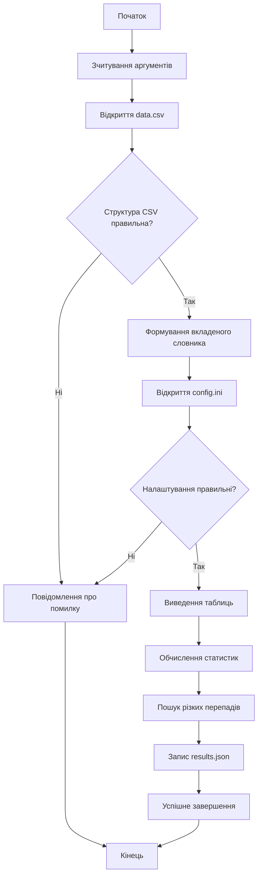

# Лабораторна робота №3
# Виконав студент групи: ІКМ-724в
# Матвейчук С. В.
## Робота з файлами користувацьких даних

### Мета роботи

Ознайомитися із засобами роботи з файлами у Python: CSV, INI та JSON. Навчитися організовувати зчитування користувацьких даних, їх перевірку, статистичну обробку та збереження результатів у файл.

---

## 1. Опис завдання

Необхідно створити програму для статистичної обробки показів температури, відносної вологості та атмосферного тиску, отриманих від системи «розумного будинку».

Програма повинна:

- зчитати часові мітки та показники з файлу `data.csv`;
- сформувати вкладений словник виду `показник → час → значення`;
- завантажити перелік необхідних характеристик із `config.ini`;
- обчислити середнє, мінімум, максимум і медіану;
- знайти перепади між сусідніми значеннями понад пороги 7 °C, 20 % і 5000 Па;
- вивести дані та результати у консоль;
- зберегти результати у файл `results.json`;
- повідомити користувача про помилки у файлах або даних.

---

## 2. Структура проєкту

```text
lab_03_python/
├── data.csv
├── config.ini
├── main.py
├── stats_utils.py
├── results.json
├── console.log
└── docs/
    └── Звіт_ЛР3_робота_з_файлами.docx
```

---

## 3. Алгоритм роботи програми

1. Отримати назви файлів із параметрів командного рядка або використати стандартні значення.
2. Відкрити `data.csv`, перевірити заголовки та перетворити значення на числа.
3. Сформувати вкладений словник із часовими мітками.
4. Відкрити `config.ini` та перевірити назви характеристик.
5. Для кожного показника вивести таблицю початкових значень.
6. Обчислити зазначені статистичні характеристики.
7. Порівняти сусідні значення та знайти різкі перепади.
8. Записати результати до `results.json`.
9. У разі помилки вивести повідомлення та завершити програму з кодом `1`.

### Алгоритм мовою Mermaid



---

## 4. Код програми

Основна програма знаходиться у файлі [`main.py`](main.py), а статистичні функції — у модулі [`stats_utils.py`](stats_utils.py).

Реалізовано:

- читання та перевірку CSV і INI;
- обчислення середнього, мінімуму, максимуму, медіани та перепадів;
- форматований вивід таблиць і результатів;
- нотацію типів;
- параметри `--data`, `--config` і `--output`;
- обробку помилок файлів, конфігурації та числових значень.

```powershell
python main.py
python main.py --data data.csv --config config.ini --output results.json
```

---

## 5. Тестові дані

Використано власний набір із 12 вимірювань за 20 жовтня 2026 року. Він відрізняється від прикладу у вказівках і містить перепади понад поріг для всіх показників.

```csv
timestamp,temperature,humidity,pressure
2026-10-20T08:00,18.7,48.0,100820
2026-10-20T09:00,19.4,49.5,100760
2026-10-20T10:00,27.2,46.8,100690
2026-10-20T11:00,26.1,72.5,100610
2026-10-20T12:00,24.8,68.2,100540
2026-10-20T13:00,16.9,64.7,94300
```

```ini
[temperature]
stats = average, min, max, median, jumps

[humidity]
stats = average, min, max, median, jumps

[pressure]
stats = average, min, max, median, jumps
```

---

## 6. Тестування програми

### Тест 1. Коректні дані

```text
temperature: average 21.41; min 14.8; max 27.2; median 20.95
humidity: average 55.41; min 41.2; max 72.5; median 54.2
pressure: average 99483.33; min 94300.0; max 100820.0; median 100455.0
Результати збережено у файлі results.json
```

Повний вивід наведено у [`console.log`](console.log), а структуровані значення — у [`results.json`](results.json).

### Тест 2. Відсутній файл даних

```powershell
python main.py --data missing.csv
```

```text
Помилка: [Errno 2] No such file or directory: 'missing.csv'
```

Програма завершується з кодом `1`.

### Тест 3. Перевірка синтаксису

```powershell
python -m py_compile main.py stats_utils.py
```

Команда завершується з кодом `0`; синтаксичних помилок не виявлено.

---

## 7. Висновок

Під час виконання лабораторної роботи створено програму для статистичної обробки показників мікроклімату з файлу користувацьких даних.

Використано модулі стандартної бібліотеки `csv`, `json`, `configparser`, `statistics`, `argparse` і `pathlib`. Дані організовано у вигляді вкладених словників, а статистичні обчислення винесено до окремого модуля.

Програма перевіряє структуру CSV, числові значення та конфігурацію, обчислює основні статистичні характеристики й визначає моменти різких перепадів між сусідніми вимірюваннями.

Додатково реалізовано нотацію типів, вибір файлів через параметри командного рядка та окремий форматований вивід результатів. У результаті закріплено практичні навички читання, перевірки, обробки й збереження даних у різних файлових форматах Python.
